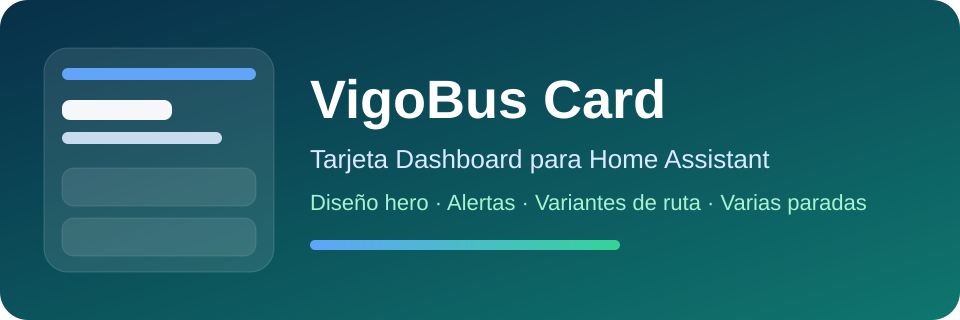

<p align="center"></p>

<p align="center">
  <a href="https://github.com/MUbeira0/lovelace-vigobus-card/blob/main/README.md">English</a> ·
  <b>Español</b> ·
  <a href="https://github.com/MUbeira0/lovelace-vigobus-card/blob/main/README.gl.md">Galego</a>
</p>

# VigoBus Card

Tarjeta de dashboard de Home Assistant para los **autobuses de Vigo (Vitrasa)**: horas de llegada, rutas, avisos, varias paradas, "mi ubicación" y un planificador de viajes con mapa.

[](https://github.com/MUbeira0/lovelace-vigobus-card/releases)
[](https://www.home-assistant.io/)
[](https://www.home-assistant.io/integrations/marketplace/)

Necesita la [integración VigoBus Pro](https://github.com/MUbeira0/vigobus-integration), que proporciona los sensores y servicios que muestra la tarjeta.

## Qué ofrece

- **Tres estilos visuales** (`card_style`): `bold` (aspecto de app de transporte, por defecto), `glass` y `glass_refined`. Se elige en el editor visual, sin YAML.
- **Insignias de línea con color**, usando los colores oficiales de Vitrasa cuando están publicados (si no, una paleta revisada para daltonismo).
- **En vivo o de horario**: cada bus lleva una pastilla, verde *En vivo* (por GPS) o gris *Horario* (solo según horario).
- **Parada principal** y **paradas secundarias** (tu parada cercana de casa y las extra configuradas en la integración). Los sensores de parada cercana por dispositivo no se listan automáticamente.
- Paginación cuando una parada tiene más buses de los que caben, **filtro de línea** opcional (global o por parada) y **avisos** de cada línea activa.
- **"Mi ubicación"**: cada móvil o tablet ve la parada más cercana a *sí mismo*.
- **Planificador de viajes** con opciones de ruta, mapa y tu posición en vivo.
- Castellano, inglés y gallego; modo compacto; sigue tu tema claro/oscuro.
- Eficiente: solo se redibuja cuando cambian las entidades que muestra.

## Requisitos

- Home Assistant **2024.1.0 o superior**.
- La integración **VigoBus Pro**. Algunas funciones piden una versión mínima:

| Función | Versión de la integración |
|---|---|
| Detección fiable de sensores por dispositivo (`is_device_nearest`) | 2.3.1+ |
| "Mi ubicación" (`vigobus.nearest_stops`) | 2.1.0+ |
| Planificador de viajes | 2.15.0+ |
| Tramos a pie por calles reales (clave OpenRouteService) | 2.17.0+ |

## Instalación

Desde Home Assistant **2026.11**, HACS está integrado en Home Assistant como [Marketplace](https://www.home-assistant.io/integrations/marketplace/).

1. Abre el **Marketplace**, busca **VigoBus Card** e instálala. El recurso del dashboard se añade solo.
2. Recarga el dashboard (limpia la caché del navegador si la tarjeta no aparece).

¿Ya la tenías con HACS? No tienes que hacer nada: Home Assistant la migra sola en el primer arranque de 2026.11 y sigue actualizándola.

**Manual / Home Assistant anterior (con HACS):** añade `https://github.com/MUbeira0/lovelace-vigobus-card` como repositorio personalizado, categoría **Dashboard**, e instala **VigoBus Card**.

### Recurso

Si el recurso no se añade solo, hazlo en *Ajustes → Paneles → ⋮ → Recursos* (tipo `Módulo JavaScript`):

```text
/local/community/lovelace-vigobus-card/vigobus-card.js
```

Con HACS anterior a 2026.11 la ruta es `/hacsfiles/lovelace-vigobus-card/vigobus-card.js`.

## Inicio rápido

Añade la tarjeta desde el editor del dashboard (**VigoBus Card**) y configúrala en el editor visual, o usa YAML:

```yaml
type: custom:vigobus-card
title: VigoBus
show_alerts: true
show_all_stops: true
```

Por defecto muestra el sensor `nearest` (casa) y todas las paradas `sensor.vigobus_*` configuradas en la integración.

## Opciones

Todo se edita desde el editor visual; el YAML se muestra como referencia.

| Opción | Por defecto | Qué hace |
|---|---|---|
| `title` | `VigoBus` | Título de la tarjeta. |
| `card_style` | `bold` | `bold`, `glass` o `glass_refined`. |
| `accent_color` | `#ff6b35` | Color de acento (cabecera, pastillas, resaltados). |
| `language` | `auto` | `auto` (sigue a Home Assistant), `es`, `en` o `gl`. |
| `compact` | `false` | Diseño más compacto. |
| `primary_entity` | vacío | Sensor usado como parada principal. Vacío = automático. |
| `show_all_stops` | `true` | Muestra la parada principal y las secundarias. |
| `max_stops` | `6` | Máximo de paradas secundarias. |
| `next_buses_count` | `3` | Buses por página antes de paginar. |
| `line_filter` | vacío | Muestra solo esta línea (p. ej. `C1`) en todo, salvo que una parada la sustituya. |
| `stops` | – | Lista de paradas; cada una admite `entity`, `title` y una `line` opcional que sustituye a `line_filter` en esa parada. |
| `show_alerts` | `true` | Muestra los avisos de servicio activos. |
| `alerts_only_main_line` | `false` | Solo avisos de la línea actual de la parada principal. |
| `alerts_max` | `3` | Máximo de avisos por parada. |
| `show_debug` | `false` | Muestra información técnica de la parada cercana (útil para reportar errores). |
| `device_location_mode` | `false` | Activa "Mi ubicación" (abajo). |
| `trip_planner_mode` | `false` | Activa el planificador de viajes (abajo). |

Una parada sin próximos buses muestra un mensaje limpio de "sin estimaciones" en lugar de marcadores.

```yaml
type: custom:vigobus-card
stops:
  - entity: sensor.vigobus_urzaiz
    title: Trabajo
    line: C1
```

## Modo "Mi ubicación"

Normalmente cada parada refleja un estado compartido de Home Assistant, igual para todos. Con `device_location_mode: true` la tarjeta pide a **cada navegador/app** su ubicación en vivo y muestra la parada más cercana a *ese* dispositivo, así que un móvil y una tablet en el mismo dashboard pueden ver paradas distintas.

La app Companion de Home Assistant funciona en un WebView donde el GPS del navegador no es fiable, así que la tarjeta puede recurrir a la **entidad `person` del usuario con sesión iniciada**. Si coincide, la sección lleva el nombre de esa persona.

```yaml
type: custom:vigobus-card
device_location_mode: true
device_location_source: auto      # auto | browser | person
device_location_title: ""         # opcional, sustituye al título automático
device_location_tie_margin_m: 60  # muestra también paradas a esta distancia de la más cercana
device_location_max_candidates: 3
device_location_refresh_seconds: 20  # mínimo 10
```

| `device_location_source` | Comportamiento |
|---|---|
| `auto` | GPS del navegador y, si no está disponible o se deniega, tu `person` (funciona en la app). |
| `browser` | Solo GPS del navegador, sin alternativa ni nombre. |
| `person` | Usa siempre las coordenadas de tu `person`. |

Para tener coordenadas frescas de `person`, activa *Ubicación en segundo plano* y *Ubicación única y precisa* en los sensores de la app Companion. Si varias paradas están a menos de `device_location_tie_margin_m` de la más cercana (por ejemplo, aceras opuestas), unos botones te dejan elegir cuál ver. Cada consulta fuerza una lectura nueva de GPS y se pausa mientras el dashboard no está visible, así que no gasta batería. Necesita la integración 2.1.0+ y permiso de ubicación en el navegador/app.

## Planificador de viajes

Pon `trip_planner_mode: true` (o usa el interruptor del editor visual) para planificar un viaje real en bus, con transbordos, desde tu ubicación actual hasta una dirección o lugar que busques (un colegio, un centro comercial, un hospital). Necesita la integración **2.15.0+**.

```yaml
type: custom:vigobus-card
trip_planner_mode: true
trip_planner_ors_api_key: ""  # opcional, ver abajo
```

1. Escribe un destino y busca. Cada resultado muestra su nombre corto y su dirección completa.
2. Elige uno: la tarjeta planifica el viaje desde tu ubicación en vivo (mismo GPS / alternativa `person` que "Mi ubicación") y lista todas las opciones razonables con horas de salida y llegada, duración, transbordos e insignias de línea.
3. Toca una fila para **activarla**: un mapa muestra los tramos a pie (gris discontinuo), cada tramo en bus con el color de su línea siguiendo la ruta real por las calles, tu inicio (azul) y el destino (rojo), y el desglose tramo a tramo.
4. Un punto verde sigue **tu posición en vivo** en el mapa. El viaje sigue activo en este navegador, incluso tras recargar, hasta que toques *Cancelar* o pase su hora de llegada.

**Rutas a pie:** por defecto los tramos a pie son una línea recta. Pon en `trip_planner_ors_api_key` tu propia clave gratuita de [OpenRouteService](https://openrouteservice.org/dev) (2000 peticiones/día) para que el primer y el último tramo a pie sigan calles reales (integración 2.17.0+). No puede ser una clave compartida, porque el plan gratuito es por clave. Sin clave, no se hace ninguna petición.

**Límites conocidos:** solo el primer tramo en bus se contrasta con datos en vivo (el resto es solo horario), un viaje planificado muy tarde por la noche puede perder un bus que empezó el día de servicio anterior, y un lugar muy nuevo puede no estar aún en OpenStreetMap.

## Privacidad y atribuciones

- La búsqueda de destino envía lo que escribes al servicio público **Nominatim** de OpenStreetMap (a través de la integración). Los resultados se atribuyen a *colaboradores de OpenStreetMap* en la tarjeta.
- El mapa usa [MapLibre GL JS](https://maplibre.org/) y teselas de [OpenFreeMap](https://openfreemap.org), cargados desde una CDN pública (`unpkg.com`) **solo mientras usas el planificador**. Se usa OpenFreeMap porque los servidores de teselas de OpenStreetMap no permiten este tipo de uso.
- Tu clave de OpenRouteService, si la pones, se guarda en la configuración de la tarjeta y solo se envía a OpenRouteService.

## Solución de problemas

- **La tarjeta no se muestra:** comprueba que el recurso está cargado y refresca la caché del dashboard.
- **Desapareció al pasar de HACS a 2026.11:** comprueba que la URL del recurso apunta a un archivo que existe (ver *Recurso*).
- **Los cambios no aparecen:** recarga la caché del navegador o de la app.
- **Faltan paradas:** confirma que la integración VigoBus Pro está instalada y que sus sensores existen.
- **"Mi ubicación" no muestra nada:** concede el permiso de ubicación o usa `device_location_source: person`.

## Desarrollo

```bash
npm test
```

Ejecuta un conjunto de pruebas sin dependencias contra `dist/vigobus-card.js` (agrupación de paradas y filtros de línea, el selector `card_style` y comprobaciones de regresión de dos errores que se publicaron antes). El CI lo ejecuta en cada push.

## Soporte

[Incidencias](https://github.com/MUbeira0/lovelace-vigobus-card/issues) · [Versiones](https://github.com/MUbeira0/lovelace-vigobus-card/releases)
