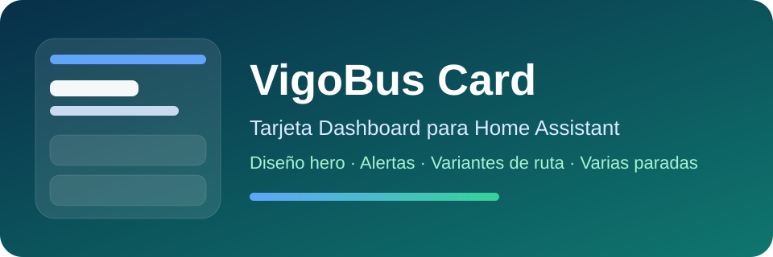

<p align="center"></p>

<p align="center">
  <a href="https://github.com/MUbeira0/lovelace-vigobus-card/blob/main/README.md">English</a> ·
  <a href="https://github.com/MUbeira0/lovelace-vigobus-card/blob/main/README.es.md">Español</a> ·
  <b>Galego</b>
</p>

# VigoBus Card

Tarxeta de dashboard de Home Assistant para os **autobuses de Vigo (Vitrasa)**: horas de chegada, rutas, avisos, varias paradas, "a miña localización" e un planificador de viaxes con mapa.

[](https://github.com/MUbeira0/lovelace-vigobus-card/releases)
[](https://www.home-assistant.io/)
[](https://www.home-assistant.io/integrations/marketplace/)

Precisa da [integración VigoBus Pro](https://github.com/MUbeira0/vigobus-integration), que proporciona os sensores e servizos que amosa a tarxeta.

## Que ofrece

- **Tres estilos visuais** (`card_style`): `bold` (aspecto de app de transporte, por defecto), `glass` e `glass_refined`. Elíxese no editor visual, sen YAML.
- **Insignias de liña con cor**, usando as cores oficiais de Vitrasa cando están publicadas (se non, unha paleta revisada para daltonismo).
- **En vivo ou de horario**: cada bus leva unha pastilla, verde *En vivo* (por GPS) ou gris *Horario* (só segundo horario).
- **Parada principal** e **paradas secundarias** (a túa parada próxima da casa e as extra configuradas na integración). Os sensores de parada próxima por dispositivo non se listan automaticamente.
- Paxinación cando unha parada ten máis buses dos que caben, **filtro de liña** opcional (global ou por parada) e **avisos** de cada liña activa.
- **"A miña localización"**: cada móbil ou tablet ve a parada máis próxima a *si mesmo*.
- **Planificador de viaxes** con opcións de ruta, mapa e a túa posición en vivo.
- Castelán, inglés e galego; modo compacto; segue o teu tema claro/escuro.
- Eficiente: só se redebuxa cando cambian as entidades que amosa.

## Requisitos

- Home Assistant **2024.1.0 ou superior**.
- A integración **VigoBus Pro**. Algunhas funcións piden unha versión mínima:

| Función | Versión da integración |
|---|---|
| Detección fiable de sensores por dispositivo (`is_device_nearest`) | 2.3.1+ |
| "A miña localización" (`vigobus.nearest_stops`) | 2.1.0+ |
| Planificador de viaxes | 2.15.0+ |
| Treitos a pé por rúas reais (clave OpenRouteService) | 2.17.0+ |

## Instalación

Desde Home Assistant **2026.11**, HACS está integrado en Home Assistant como [Marketplace](https://www.home-assistant.io/integrations/marketplace/).

1. Abre o **Marketplace**, busca **VigoBus Card** e instálaa. O recurso do dashboard engádese só.
2. Recarga o dashboard (limpa a caché do navegador se a tarxeta non aparece).

Xa a tiñas con HACS? Non tes que facer nada: Home Assistant migra só no primeiro arranque de 2026.11 e segue actualizándoa.

**Manual / Home Assistant anterior (con HACS):** engade `https://github.com/MUbeira0/lovelace-vigobus-card` como repositorio personalizado, categoría **Dashboard**, e instala **VigoBus Card**.

### Recurso

Se o recurso non se engade só, fai o en *Axustes → Paneis → ⋮ → Recursos* (tipo `Módulo JavaScript`):

```text
/local/community/lovelace-vigobus-card/vigobus-card.js
```

Con HACS anterior a 2026.11 a ruta é `/hacsfiles/lovelace-vigobus-card/vigobus-card.js`.

## Inicio rápido

Engade a tarxeta desde o editor do dashboard (**VigoBus Card**) e configúraa no editor visual, ou usa YAML:

```yaml
type: custom:vigobus-card
title: VigoBus
show_alerts: true
show_all_stops: true
```

Por defecto amosa o sensor `nearest` (casa) e todas as paradas `sensor.vigobus_*` configuradas na integración.

## Opcións

Todo se edita desde o editor visual; o YAML amósase como referencia.

| Opción | Por defecto | Que fai |
|---|---|---|
| `title` | `VigoBus` | Título da tarxeta. |
| `card_style` | `bold` | `bold`, `glass` ou `glass_refined`. |
| `accent_color` | `#ff6b35` | Cor de acento (cabeceira, pastillas, realces). |
| `language` | `auto` | `auto` (segue a Home Assistant), `es`, `en` ou `gl`. |
| `compact` | `false` | Deseño máis compacto. |
| `primary_entity` | baleiro | Sensor usado como parada principal. Baleiro = automático. |
| `show_all_stops` | `true` | Amosa a parada principal e as secundarias. |
| `max_stops` | `6` | Máximo de paradas secundarias. |
| `next_buses_count` | `3` | Buses por páxina antes de paxinar. |
| `line_filter` | baleiro | Amosa só esta liña (p. ex. `C1`) en todo, salvo que unha parada a substitúa. |
| `stops` | – | Lista de paradas; cada unha admite `entity`, `title` e unha `line` opcional que substitúe a `line_filter` nesa parada. |
| `show_alerts` | `true` | Amosa os avisos de servizo activos. |
| `alerts_only_main_line` | `false` | Só avisos da liña actual da parada principal. |
| `alerts_max` | `3` | Máximo de avisos por parada. |
| `show_debug` | `false` | Amosa información técnica da parada próxima (útil para reportar erros). |
| `device_location_mode` | `false` | Activa "A miña localización" (abaixo). |
| `trip_planner_mode` | `false` | Activa o planificador de viaxes (abaixo). |

Unha parada sen próximos buses amosa unha mensaxe limpa de "sen estimacións" en vez de marcadores.

```yaml
type: custom:vigobus-card
stops:
  - entity: sensor.vigobus_urzaiz
    title: Traballo
    line: C1
```

## Modo "A miña localización"

Normalmente cada parada reflicte un estado compartido de Home Assistant, igual para todos. Con `device_location_mode: true` a tarxeta pide a **cada navegador/app** a súa localización en vivo e amosa a parada máis próxima a *ese* dispositivo, así que un móbil e unha tablet no mesmo dashboard poden ver paradas distintas.

A app Companion de Home Assistant funciona nun WebView onde o GPS do navegador non é fiable, así que a tarxeta pode recorrer á **entidade `person` do usuario con sesión iniciada**. Se coincide, a sección leva o nome desa persoa.

```yaml
type: custom:vigobus-card
device_location_mode: true
device_location_source: auto      # auto | browser | person
device_location_title: ""         # opcional, substitúe o título automático
device_location_tie_margin_m: 60  # amosa tamén paradas a esta distancia da máis próxima
device_location_max_candidates: 3
device_location_refresh_seconds: 20  # mínimo 10
```

| `device_location_source` | Comportamento |
|---|---|
| `auto` | GPS do navegador e, se non está dispoñible ou se denega, o teu `person` (funciona na app). |
| `browser` | Só GPS do navegador, sen alternativa nin nome. |
| `person` | Usa sempre as coordenadas do teu `person`. |

Para ter coordenadas frescas de `person`, activa *Localización en segundo plano* e *Localización única e precisa* nos sensores da app Companion. Se varias paradas están a menos de `device_location_tie_margin_m` da máis próxima (por exemplo, beirarrúas opostas), uns botóns déixanche elixir cal ver. Cada consulta forza unha lectura nova de GPS e pásase en pausa mentres o dashboard non está visible, así que non gasta batería. Precisa a integración 2.1.0+ e permiso de localización no navegador/app.

## Planificador de viaxes

Pon `trip_planner_mode: true` (ou usa o interruptor do editor visual) para planificar unha viaxe real en bus, con transbordos, desde a túa localización actual ata un enderezo ou lugar que busques (un colexio, un centro comercial, un hospital). Precisa a integración **2.15.0+**.

```yaml
type: custom:vigobus-card
trip_planner_mode: true
trip_planner_ors_api_key: ""  # opcional, ver abaixo
```

1. Escribe un destino e busca. Cada resultado amosa o seu nome curto e o seu enderezo completo.
2. Elixe un: a tarxeta planifica a viaxe desde a túa localización en vivo (mesmo GPS / alternativa `person` que "A miña localización") e lista todas as opcións razoables con horas de saída e chegada, duración, transbordos e insignias de liña.
3. Toca unha fila para **activala**: un mapa amosa os treitos a pé (gris descontinuo), cada treito en bus coa cor da súa liña seguindo a ruta real polas rúas, o teu inicio (azul) e o destino (vermello), e o desglose treito a treito.
4. Un punto verde segue **a túa posición en vivo** no mapa. A viaxe segue activa neste navegador, incluso tras recargar, ata que toques *Cancelar* ou pase a súa hora de chegada.

**Rutas a pé:** por defecto os treitos a pé son unha liña recta. Pon en `trip_planner_ors_api_key` a túa propia clave gratuíta de [OpenRouteService](https://openrouteservice.org/dev) (2000 peticións/día) para que o primeiro e o último treito a pé sigan rúas reais (integración 2.17.0+). Non pode ser unha clave compartida, porque o plan gratuíto é por clave. Sen clave, non se fai ningunha petición.

**Límites coñecidos:** só o primeiro treito en bus se contrasta con datos en vivo (o resto é só horario), unha viaxe planificada moi tarde pola noite pode perder un bus que comezou o día de servizo anterior, e un lugar moi novo pode non estar aínda en OpenStreetMap.

## Privacidade e atribucións

- A busca de destino envía o que escribes ao servizo público **Nominatim** de OpenStreetMap (a través da integración). Os resultados atribúense a *colaboradores de OpenStreetMap* na tarxeta.
- O mapa usa [MapLibre GL JS](https://maplibre.org/) e tesselas de [OpenFreeMap](https://openfreemap.org), cargados desde unha CDN pública (`unpkg.com`) **só mentres usas o planificador**. Úsase OpenFreeMap porque os servidores de tesselas de OpenStreetMap non permiten este tipo de uso.
- A túa clave de OpenRouteService, se a pos, gárdase na configuración da tarxeta e só se envía a OpenRouteService.

## Solución de problemas

- **A tarxeta non se amosa:** comproba que o recurso está cargado e refresca a caché do dashboard.
- **Desapareceu ao pasar de HACS a 2026.11:** comproba que a URL do recurso apunta a un arquivo que existe (ver *Recurso*).
- **Os cambios non aparecen:** recarga a caché do navegador ou da app.
- **Faltan paradas:** confirma que a integración VigoBus Pro está instalada e que os seus sensores existen.
- **"A miña localización" non amosa nada:** concede o permiso de localización ou usa `device_location_source: person`.

## Desenvolvemento

```bash
npm test
```

Executa un conxunto de probas sen dependencias contra `dist/vigobus-card.js` (agrupación de paradas e filtros de liña, o selector `card_style` e comprobacións de regresión de dous erros que se publicaron antes). O CI execútao en cada push.

## Soporte

[Incidencias](https://github.com/MUbeira0/lovelace-vigobus-card/issues) · [Versións](https://github.com/MUbeira0/lovelace-vigobus-card/releases)
