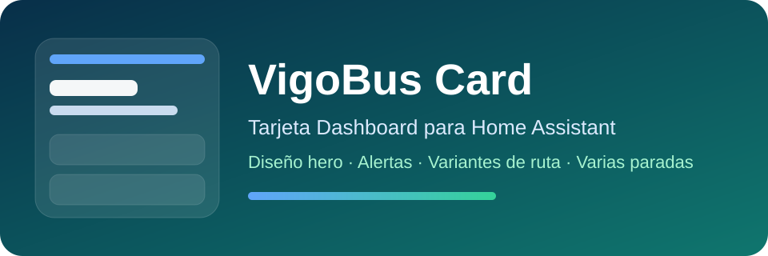

<p align="center"></p>

<p align="center"> <b>English</b> ·  <a href="#espanol">Español</a> ·  <a href="#galego">Galego</a><br><sub>Español y Galego están más abajo, en este mismo documento · Español e Galego están máis abaixo, neste mesmo documento</sub></p>

# VigoBus Card

[](https://github.com/MUbeira0/lovelace-vigobus-card/releases)
[](https://www.home-assistant.io/)
[](https://www.home-assistant.io/integrations/marketplace/)

Home Assistant dashboard card for the **buses of Vigo (Vitrasa)**: arrival times, routes, alerts, several stops, "my location" and a trip planner with a map.


It needs the [VigoBus Pro integration](https://github.com/MUbeira0/vigobus-integration), which provides the sensors and services the card shows.

## What you get

- **Three visual styles** (`card_style`): `bold` (transit-app look, default), `glass` and `glass_refined`. Pick one from the visual editor, no YAML needed.
- **Colour-coded line badges** using Vitrasa's official colours when published (otherwise a colour-blind-checked palette).
- **Live or scheduled**: each bus has a small pill, green *Live* (GPS-tracked) or grey *Scheduled* (timetable only).
- **Main stop** plus **secondary stops** (your home nearest stop and any extra stop configured in the integration). Per-device nearest sensors are not listed automatically.
- Pagination when a stop has more buses than fit, optional **line filter** (global or per stop) and **alerts** per active line.
- **"My location"**: each phone or tablet sees the stop closest to *itself*.
- **Trip planner** with route options, a map and your live position.
- Spanish, English and Galician; compact mode; follows your light/dark theme.
- Efficient: it only redraws when the entities it shows change.

## Requirements

- Home Assistant **2024.1.0 or newer**.
- The **VigoBus Pro** integration. Some features need a minimum version:

| Feature | Integration version |
|---|---|
| Reliable per-device sensor detection (`is_device_nearest`) | 2.3.1+ |
| "My location" (`vigobus.nearest_stops`) | 2.1.0+ |
| Trip planner | 2.15.0+ |
| Street-level walking legs (OpenRouteService key) | 2.17.0+ |

## Installation

Since Home Assistant **2026.11**, HACS is built into Home Assistant as the [Marketplace](https://www.home-assistant.io/integrations/marketplace/).

1. Open the **Marketplace**, search for **VigoBus Card** and install it. The dashboard resource is added for you.
2. Reload the dashboard (clear the browser cache if the card does not show up).

Already installed with HACS? Nothing to do: Home Assistant migrates it automatically on the first start of 2026.11 and keeps updating it.

**Manual / older Home Assistant (with HACS):** add `https://github.com/MUbeira0/lovelace-vigobus-card` as a custom repository, category **Dashboard**, then install **VigoBus Card**.

### Resource

If the resource is not added automatically, add it under *Settings → Dashboards → ⋮ → Resources* (type `JavaScript module`):

```text
/local/community/lovelace-vigobus-card/vigobus-card.js
```

On HACS before 2026.11 the path is `/hacsfiles/lovelace-vigobus-card/vigobus-card.js`.

## Quick start

Add the card from the dashboard editor (**VigoBus Card**) and configure it in the visual editor, or use YAML:

```yaml
type: custom:vigobus-card
title: VigoBus
show_alerts: true
show_all_stops: true
```

By default it shows the `nearest` (home) sensor and every `sensor.vigobus_*` stop configured in the integration.

## Options

Everything is editable from the visual editor; YAML is shown for reference.

| Option | Default | What it does |
|---|---|---|
| `title` | `VigoBus` | Card title. |
| `card_style` | `bold` | `bold`, `glass` or `glass_refined`. |
| `accent_color` | `#ff6b35` | Accent colour (hero, pills, highlights). |
| `language` | `auto` | `auto` (follows Home Assistant), `es`, `en` or `gl`. |
| `compact` | `false` | Tighter layout. |
| `primary_entity` | empty | Sensor used as the main stop. Empty = automatic. |
| `show_all_stops` | `true` | Show the main stop plus the secondary ones. |
| `max_stops` | `6` | Maximum number of secondary stops. |
| `next_buses_count` | `3` | Buses per page before pagination. |
| `line_filter` | empty | Only show this line (e.g. `C1`) everywhere, unless a stop overrides it. |
| `stops` | – | List of stops; each accepts `entity`, `title` and an optional `line` that overrides `line_filter` for that stop. |
| `show_alerts` | `true` | Show active service alerts. |
| `alerts_only_main_line` | `false` | Only alerts of the main stop's current line. |
| `alerts_max` | `3` | Maximum alerts per stop. |
| `show_debug` | `false` | Shows technical info about the nearest stop (useful for bug reports). |
| `device_location_mode` | `false` | Enables "My location" (below). |
| `trip_planner_mode` | `false` | Enables the trip planner (below). |

A stop with no upcoming buses shows a clean "no estimates" message instead of placeholders.

```yaml
type: custom:vigobus-card
stops:
  - entity: sensor.vigobus_urzaiz
    title: Work
    line: C1
```

## "My location" mode

Normally every stop reflects one shared Home Assistant state, the same for everyone. With `device_location_mode: true` the card asks **each device's own browser/app** for its live location and shows the stop closest to *that* device, so a phone and a tablet on the same dashboard can show different stops.

The Home Assistant Companion app runs in a WebView where browser GPS is unreliable, so the card can fall back to the **`person` entity of the logged-in user**. If it matches, the section is titled with that person's name.

```yaml
type: custom:vigobus-card
device_location_mode: true
device_location_source: auto      # auto | browser | person
device_location_title: ""         # optional, replaces the automatic heading
device_location_tie_margin_m: 60  # also show stops this close to the nearest one
device_location_max_candidates: 3
device_location_refresh_seconds: 20  # minimum 10
```

| `device_location_source` | Behaviour |
|---|---|
| `auto` | Browser GPS, falling back to your `person` if it is unavailable or denied (works in the app). |
| `browser` | Browser GPS only, no fallback and no name. |
| `person` | Always use your `person` coordinates. |

For fresh `person` coordinates, enable *Background location* and *Single accurate location* in the Companion app sensors. If several stops are within `device_location_tie_margin_m` of the closest one (for example opposite sidewalks), chips let you choose which one to see. Each lookup forces a new GPS fix and pauses while the dashboard is not visible, so it does not waste battery. It needs integration 2.1.0+ and location permission in the browser/app.

## Trip planner

Set `trip_planner_mode: true` (or use the toggle in the visual editor) to plan a real bus trip, with transfers, from your current location to an address or place you search for (a school, a mall, a hospital). It needs integration **2.15.0+**.

```yaml
type: custom:vigobus-card
trip_planner_mode: true
trip_planner_ors_api_key: ""  # optional, see below
```

1. Type a destination and search. Each result shows its short name and full address.
2. Pick one: the card plans the trip from your live location (same geolocation / `person` fallback as "My location") and lists every reasonable option with departure and arrival times, duration, transfers and line badges.
3. Tap a row to **activate** it: a map shows the walk legs (dashed grey), each bus leg in its line colour following the real street route, your start (blue) and destination (red), and the full leg-by-leg breakdown.
4. A green dot follows **your live position** on the map. The trip stays active in this browser, even after a reload, until you tap *Cancel* or its arrival time passes.

**Walking routes:** walk legs are a straight line by default. Set `trip_planner_ors_api_key` to your own free [OpenRouteService](https://openrouteservice.org/dev) key (2000 requests/day) so the first and last walk legs follow real streets (integration 2.17.0+). It cannot be a shared key, because the free tier is per key. Without a key, nothing is requested.

**Known limits:** only the first bus leg is checked against live data (the rest is timetable only), a trip planned very late at night may miss a bus that started the previous service day, and a very new place may not be in OpenStreetMap yet.

## Privacy and attributions

- Destination search sends what you type to OpenStreetMap's public **Nominatim** service (through the integration). Results are credited to *OpenStreetMap contributors* in the card.
- The map uses [MapLibre GL JS](https://maplibre.org/) and [OpenFreeMap](https://openfreemap.org) tiles, loaded from a public CDN (`unpkg.com`) **only while the trip planner is in use**. OpenFreeMap is used because OpenStreetMap's own tile servers do not allow this kind of usage.
- Your OpenRouteService key, if you set one, is stored in the card configuration and is only sent to OpenRouteService.

## Troubleshooting

- **The card does not render:** check that the resource is loaded and refresh the dashboard cache.
- **It disappeared after moving from HACS to 2026.11:** check that the resource URL points to a file that exists (see *Resource*).
- **Changes do not appear:** reload the browser or the app cache.
- **Stops are missing:** confirm the VigoBus Pro integration is installed and its sensors exist.
- **"My location" shows nothing:** grant location permission, or use `device_location_source: person`.

## Development

```bash
npm test
```

Runs a dependency-free suite against `dist/vigobus-card.js` (stop grouping and line filters, the `card_style` selector, and regression checks for two bugs that shipped before). CI runs it on every push.

## Support

[Issues](https://github.com/MUbeira0/lovelace-vigobus-card/issues) · [Releases](https://github.com/MUbeira0/lovelace-vigobus-card/releases)

---

<a id="espanol"></a>
<details>
<summary><h2> Español</h2></summary>

Tarjeta de dashboard de Home Assistant para los **autobuses de Vigo (Vitrasa)**: horas de llegada, rutas, avisos, varias paradas, "mi ubicación" y un planificador de viajes con mapa.


Necesita la [integración VigoBus Pro](https://github.com/MUbeira0/vigobus-integration), que proporciona los sensores y servicios que muestra la tarjeta.

## Qué ofrece

- **Tres estilos visuales** (`card_style`): `bold` (aspecto de app de transporte, por defecto), `glass` y `glass_refined`. Se elige en el editor visual, sin YAML.
- **Insignias de línea con color**, usando los colores oficiales de Vitrasa cuando están publicados (si no, una paleta revisada para daltonismo).
- **En vivo o de horario**: cada bus lleva una pastilla, verde *En vivo* (por GPS) o gris *Horario* (solo según horario).
- **Parada principal** y **paradas secundarias** (tu parada cercana de casa y las extra configuradas en la integración). Los sensores de parada cercana por dispositivo no se listan automáticamente.
- Paginación cuando una parada tiene más buses de los que caben, **filtro de línea** opcional (global o por parada) y **avisos** de cada línea activa.
- **"Mi ubicación"**: cada móvil o tablet ve la parada más cercana a *sí mismo*.
- **Planificador de viajes** con opciones de ruta, mapa y tu posición en vivo.
- Castellano, inglés y gallego; modo compacto; sigue tu tema claro/oscuro.
- Eficiente: solo se redibuja cuando cambian las entidades que muestra.

## Requisitos

- Home Assistant **2024.1.0 o superior**.
- La integración **VigoBus Pro**. Algunas funciones piden una versión mínima:

| Función | Versión de la integración |
|---|---|
| Detección fiable de sensores por dispositivo (`is_device_nearest`) | 2.3.1+ |
| "Mi ubicación" (`vigobus.nearest_stops`) | 2.1.0+ |
| Planificador de viajes | 2.15.0+ |
| Tramos a pie por calles reales (clave OpenRouteService) | 2.17.0+ |

## Instalación

Desde Home Assistant **2026.11**, HACS está integrado en Home Assistant como [Marketplace](https://www.home-assistant.io/integrations/marketplace/).

1. Abre el **Marketplace**, busca **VigoBus Card** e instálala. El recurso del dashboard se añade solo.
2. Recarga el dashboard (limpia la caché del navegador si la tarjeta no aparece).

¿Ya la tenías con HACS? No tienes que hacer nada: Home Assistant la migra sola en el primer arranque de 2026.11 y sigue actualizándola.

**Manual / Home Assistant anterior (con HACS):** añade `https://github.com/MUbeira0/lovelace-vigobus-card` como repositorio personalizado, categoría **Dashboard**, e instala **VigoBus Card**.

### Recurso

Si el recurso no se añade solo, hazlo en *Ajustes → Paneles → ⋮ → Recursos* (tipo `Módulo JavaScript`):

```text
/local/community/lovelace-vigobus-card/vigobus-card.js
```

Con HACS anterior a 2026.11 la ruta es `/hacsfiles/lovelace-vigobus-card/vigobus-card.js`.

## Inicio rápido

Añade la tarjeta desde el editor del dashboard (**VigoBus Card**) y configúrala en el editor visual, o usa YAML:

```yaml
type: custom:vigobus-card
title: VigoBus
show_alerts: true
show_all_stops: true
```

Por defecto muestra el sensor `nearest` (casa) y todas las paradas `sensor.vigobus_*` configuradas en la integración.

## Opciones

Todo se edita desde el editor visual; el YAML se muestra como referencia.

| Opción | Por defecto | Qué hace |
|---|---|---|
| `title` | `VigoBus` | Título de la tarjeta. |
| `card_style` | `bold` | `bold`, `glass` o `glass_refined`. |
| `accent_color` | `#ff6b35` | Color de acento (cabecera, pastillas, resaltados). |
| `language` | `auto` | `auto` (sigue a Home Assistant), `es`, `en` o `gl`. |
| `compact` | `false` | Diseño más compacto. |
| `primary_entity` | vacío | Sensor usado como parada principal. Vacío = automático. |
| `show_all_stops` | `true` | Muestra la parada principal y las secundarias. |
| `max_stops` | `6` | Máximo de paradas secundarias. |
| `next_buses_count` | `3` | Buses por página antes de paginar. |
| `line_filter` | vacío | Muestra solo esta línea (p. ej. `C1`) en todo, salvo que una parada la sustituya. |
| `stops` | – | Lista de paradas; cada una admite `entity`, `title` y una `line` opcional que sustituye a `line_filter` en esa parada. |
| `show_alerts` | `true` | Muestra los avisos de servicio activos. |
| `alerts_only_main_line` | `false` | Solo avisos de la línea actual de la parada principal. |
| `alerts_max` | `3` | Máximo de avisos por parada. |
| `show_debug` | `false` | Muestra información técnica de la parada cercana (útil para reportar errores). |
| `device_location_mode` | `false` | Activa "Mi ubicación" (abajo). |
| `trip_planner_mode` | `false` | Activa el planificador de viajes (abajo). |

Una parada sin próximos buses muestra un mensaje limpio de "sin estimaciones" en lugar de marcadores.

```yaml
type: custom:vigobus-card
stops:
  - entity: sensor.vigobus_urzaiz
    title: Trabajo
    line: C1
```

## Modo "Mi ubicación"

Normalmente cada parada refleja un estado compartido de Home Assistant, igual para todos. Con `device_location_mode: true` la tarjeta pide a **cada navegador/app** su ubicación en vivo y muestra la parada más cercana a *ese* dispositivo, así que un móvil y una tablet en el mismo dashboard pueden ver paradas distintas.

La app Companion de Home Assistant funciona en un WebView donde el GPS del navegador no es fiable, así que la tarjeta puede recurrir a la **entidad `person` del usuario con sesión iniciada**. Si coincide, la sección lleva el nombre de esa persona.

```yaml
type: custom:vigobus-card
device_location_mode: true
device_location_source: auto      # auto | browser | person
device_location_title: ""         # opcional, sustituye al título automático
device_location_tie_margin_m: 60  # muestra también paradas a esta distancia de la más cercana
device_location_max_candidates: 3
device_location_refresh_seconds: 20  # mínimo 10
```

| `device_location_source` | Comportamiento |
|---|---|
| `auto` | GPS del navegador y, si no está disponible o se deniega, tu `person` (funciona en la app). |
| `browser` | Solo GPS del navegador, sin alternativa ni nombre. |
| `person` | Usa siempre las coordenadas de tu `person`. |

Para tener coordenadas frescas de `person`, activa *Ubicación en segundo plano* y *Ubicación única y precisa* en los sensores de la app Companion. Si varias paradas están a menos de `device_location_tie_margin_m` de la más cercana (por ejemplo, aceras opuestas), unos botones te dejan elegir cuál ver. Cada consulta fuerza una lectura nueva de GPS y se pausa mientras el dashboard no está visible, así que no gasta batería. Necesita la integración 2.1.0+ y permiso de ubicación en el navegador/app.

## Planificador de viajes

Pon `trip_planner_mode: true` (o usa el interruptor del editor visual) para planificar un viaje real en bus, con transbordos, desde tu ubicación actual hasta una dirección o lugar que busques (un colegio, un centro comercial, un hospital). Necesita la integración **2.15.0+**.

```yaml
type: custom:vigobus-card
trip_planner_mode: true
trip_planner_ors_api_key: ""  # opcional, ver abajo
```

1. Escribe un destino y busca. Cada resultado muestra su nombre corto y su dirección completa.
2. Elige uno: la tarjeta planifica el viaje desde tu ubicación en vivo (mismo GPS / alternativa `person` que "Mi ubicación") y lista todas las opciones razonables con horas de salida y llegada, duración, transbordos e insignias de línea.
3. Toca una fila para **activarla**: un mapa muestra los tramos a pie (gris discontinuo), cada tramo en bus con el color de su línea siguiendo la ruta real por las calles, tu inicio (azul) y el destino (rojo), y el desglose tramo a tramo.
4. Un punto verde sigue **tu posición en vivo** en el mapa. El viaje sigue activo en este navegador, incluso tras recargar, hasta que toques *Cancelar* o pase su hora de llegada.

**Rutas a pie:** por defecto los tramos a pie son una línea recta. Pon en `trip_planner_ors_api_key` tu propia clave gratuita de [OpenRouteService](https://openrouteservice.org/dev) (2000 peticiones/día) para que el primer y el último tramo a pie sigan calles reales (integración 2.17.0+). No puede ser una clave compartida, porque el plan gratuito es por clave. Sin clave, no se hace ninguna petición.

**Límites conocidos:** solo el primer tramo en bus se contrasta con datos en vivo (el resto es solo horario), un viaje planificado muy tarde por la noche puede perder un bus que empezó el día de servicio anterior, y un lugar muy nuevo puede no estar aún en OpenStreetMap.

## Privacidad y atribuciones

- La búsqueda de destino envía lo que escribes al servicio público **Nominatim** de OpenStreetMap (a través de la integración). Los resultados se atribuyen a *colaboradores de OpenStreetMap* en la tarjeta.
- El mapa usa [MapLibre GL JS](https://maplibre.org/) y teselas de [OpenFreeMap](https://openfreemap.org), cargados desde una CDN pública (`unpkg.com`) **solo mientras usas el planificador**. Se usa OpenFreeMap porque los servidores de teselas de OpenStreetMap no permiten este tipo de uso.
- Tu clave de OpenRouteService, si la pones, se guarda en la configuración de la tarjeta y solo se envía a OpenRouteService.

## Solución de problemas

- **La tarjeta no se muestra:** comprueba que el recurso está cargado y refresca la caché del dashboard.
- **Desapareció al pasar de HACS a 2026.11:** comprueba que la URL del recurso apunta a un archivo que existe (ver *Recurso*).
- **Los cambios no aparecen:** recarga la caché del navegador o de la app.
- **Faltan paradas:** confirma que la integración VigoBus Pro está instalada y que sus sensores existen.
- **"Mi ubicación" no muestra nada:** concede el permiso de ubicación o usa `device_location_source: person`.

## Desarrollo

```bash
npm test
```

Ejecuta un conjunto de pruebas sin dependencias contra `dist/vigobus-card.js` (agrupación de paradas y filtros de línea, el selector `card_style` y comprobaciones de regresión de dos errores que se publicaron antes). El CI lo ejecuta en cada push.

## Soporte

[Incidencias](https://github.com/MUbeira0/lovelace-vigobus-card/issues) · [Versiones](https://github.com/MUbeira0/lovelace-vigobus-card/releases)

</details>

<a id="galego"></a>
<details>
<summary><h2> Galego</h2></summary>

Tarxeta de dashboard de Home Assistant para os **autobuses de Vigo (Vitrasa)**: horas de chegada, rutas, avisos, varias paradas, "a miña localización" e un planificador de viaxes con mapa.


Precisa da [integración VigoBus Pro](https://github.com/MUbeira0/vigobus-integration), que proporciona os sensores e servizos que amosa a tarxeta.

## Que ofrece

- **Tres estilos visuais** (`card_style`): `bold` (aspecto de app de transporte, por defecto), `glass` e `glass_refined`. Elíxese no editor visual, sen YAML.
- **Insignias de liña con cor**, usando as cores oficiais de Vitrasa cando están publicadas (se non, unha paleta revisada para daltonismo).
- **En vivo ou de horario**: cada bus leva unha pastilla, verde *En vivo* (por GPS) ou gris *Horario* (só segundo horario).
- **Parada principal** e **paradas secundarias** (a túa parada próxima da casa e as extra configuradas na integración). Os sensores de parada próxima por dispositivo non se listan automaticamente.
- Paxinación cando unha parada ten máis buses dos que caben, **filtro de liña** opcional (global ou por parada) e **avisos** de cada liña activa.
- **"A miña localización"**: cada móbil ou tablet ve a parada máis próxima a *si mesmo*.
- **Planificador de viaxes** con opcións de ruta, mapa e a túa posición en vivo.
- Castelán, inglés e galego; modo compacto; segue o teu tema claro/escuro.
- Eficiente: só se redebuxa cando cambian as entidades que amosa.

## Requisitos

- Home Assistant **2024.1.0 ou superior**.
- A integración **VigoBus Pro**. Algunhas funcións piden unha versión mínima:

| Función | Versión da integración |
|---|---|
| Detección fiable de sensores por dispositivo (`is_device_nearest`) | 2.3.1+ |
| "A miña localización" (`vigobus.nearest_stops`) | 2.1.0+ |
| Planificador de viaxes | 2.15.0+ |
| Treitos a pé por rúas reais (clave OpenRouteService) | 2.17.0+ |

## Instalación

Desde Home Assistant **2026.11**, HACS está integrado en Home Assistant como [Marketplace](https://www.home-assistant.io/integrations/marketplace/).

1. Abre o **Marketplace**, busca **VigoBus Card** e instálaa. O recurso do dashboard engádese só.
2. Recarga o dashboard (limpa a caché do navegador se a tarxeta non aparece).

Xa a tiñas con HACS? Non tes que facer nada: Home Assistant migra só no primeiro arranque de 2026.11 e segue actualizándoa.

**Manual / Home Assistant anterior (con HACS):** engade `https://github.com/MUbeira0/lovelace-vigobus-card` como repositorio personalizado, categoría **Dashboard**, e instala **VigoBus Card**.

### Recurso

Se o recurso non se engade só, fai o en *Axustes → Paneis → ⋮ → Recursos* (tipo `Módulo JavaScript`):

```text
/local/community/lovelace-vigobus-card/vigobus-card.js
```

Con HACS anterior a 2026.11 a ruta é `/hacsfiles/lovelace-vigobus-card/vigobus-card.js`.

## Inicio rápido

Engade a tarxeta desde o editor do dashboard (**VigoBus Card**) e configúraa no editor visual, ou usa YAML:

```yaml
type: custom:vigobus-card
title: VigoBus
show_alerts: true
show_all_stops: true
```

Por defecto amosa o sensor `nearest` (casa) e todas as paradas `sensor.vigobus_*` configuradas na integración.

## Opcións

Todo se edita desde o editor visual; o YAML amósase como referencia.

| Opción | Por defecto | Que fai |
|---|---|---|
| `title` | `VigoBus` | Título da tarxeta. |
| `card_style` | `bold` | `bold`, `glass` ou `glass_refined`. |
| `accent_color` | `#ff6b35` | Cor de acento (cabeceira, pastillas, realces). |
| `language` | `auto` | `auto` (segue a Home Assistant), `es`, `en` ou `gl`. |
| `compact` | `false` | Deseño máis compacto. |
| `primary_entity` | baleiro | Sensor usado como parada principal. Baleiro = automático. |
| `show_all_stops` | `true` | Amosa a parada principal e as secundarias. |
| `max_stops` | `6` | Máximo de paradas secundarias. |
| `next_buses_count` | `3` | Buses por páxina antes de paxinar. |
| `line_filter` | baleiro | Amosa só esta liña (p. ex. `C1`) en todo, salvo que unha parada a substitúa. |
| `stops` | – | Lista de paradas; cada unha admite `entity`, `title` e unha `line` opcional que substitúe a `line_filter` nesa parada. |
| `show_alerts` | `true` | Amosa os avisos de servizo activos. |
| `alerts_only_main_line` | `false` | Só avisos da liña actual da parada principal. |
| `alerts_max` | `3` | Máximo de avisos por parada. |
| `show_debug` | `false` | Amosa información técnica da parada próxima (útil para reportar erros). |
| `device_location_mode` | `false` | Activa "A miña localización" (abaixo). |
| `trip_planner_mode` | `false` | Activa o planificador de viaxes (abaixo). |

Unha parada sen próximos buses amosa unha mensaxe limpa de "sen estimacións" en vez de marcadores.

```yaml
type: custom:vigobus-card
stops:
  - entity: sensor.vigobus_urzaiz
    title: Traballo
    line: C1
```

## Modo "A miña localización"

Normalmente cada parada reflicte un estado compartido de Home Assistant, igual para todos. Con `device_location_mode: true` a tarxeta pide a **cada navegador/app** a súa localización en vivo e amosa a parada máis próxima a *ese* dispositivo, así que un móbil e unha tablet no mesmo dashboard poden ver paradas distintas.

A app Companion de Home Assistant funciona nun WebView onde o GPS do navegador non é fiable, así que a tarxeta pode recorrer á **entidade `person` do usuario con sesión iniciada**. Se coincide, a sección leva o nome desa persoa.

```yaml
type: custom:vigobus-card
device_location_mode: true
device_location_source: auto      # auto | browser | person
device_location_title: ""         # opcional, substitúe o título automático
device_location_tie_margin_m: 60  # amosa tamén paradas a esta distancia da máis próxima
device_location_max_candidates: 3
device_location_refresh_seconds: 20  # mínimo 10
```

| `device_location_source` | Comportamento |
|---|---|
| `auto` | GPS do navegador e, se non está dispoñible ou se denega, o teu `person` (funciona na app). |
| `browser` | Só GPS do navegador, sen alternativa nin nome. |
| `person` | Usa sempre as coordenadas do teu `person`. |

Para ter coordenadas frescas de `person`, activa *Localización en segundo plano* e *Localización única e precisa* nos sensores da app Companion. Se varias paradas están a menos de `device_location_tie_margin_m` da máis próxima (por exemplo, beirarrúas opostas), uns botóns déixanche elixir cal ver. Cada consulta forza unha lectura nova de GPS e pásase en pausa mentres o dashboard non está visible, así que non gasta batería. Precisa a integración 2.1.0+ e permiso de localización no navegador/app.

## Planificador de viaxes

Pon `trip_planner_mode: true` (ou usa o interruptor do editor visual) para planificar unha viaxe real en bus, con transbordos, desde a túa localización actual ata un enderezo ou lugar que busques (un colexio, un centro comercial, un hospital). Precisa a integración **2.15.0+**.

```yaml
type: custom:vigobus-card
trip_planner_mode: true
trip_planner_ors_api_key: ""  # opcional, ver abaixo
```

1. Escribe un destino e busca. Cada resultado amosa o seu nome curto e o seu enderezo completo.
2. Elixe un: a tarxeta planifica a viaxe desde a túa localización en vivo (mesmo GPS / alternativa `person` que "A miña localización") e lista todas as opcións razoables con horas de saída e chegada, duración, transbordos e insignias de liña.
3. Toca unha fila para **activala**: un mapa amosa os treitos a pé (gris descontinuo), cada treito en bus coa cor da súa liña seguindo a ruta real polas rúas, o teu inicio (azul) e o destino (vermello), e o desglose treito a treito.
4. Un punto verde segue **a túa posición en vivo** no mapa. A viaxe segue activa neste navegador, incluso tras recargar, ata que toques *Cancelar* ou pase a súa hora de chegada.

**Rutas a pé:** por defecto os treitos a pé son unha liña recta. Pon en `trip_planner_ors_api_key` a túa propia clave gratuíta de [OpenRouteService](https://openrouteservice.org/dev) (2000 peticións/día) para que o primeiro e o último treito a pé sigan rúas reais (integración 2.17.0+). Non pode ser unha clave compartida, porque o plan gratuíto é por clave. Sen clave, non se fai ningunha petición.

**Límites coñecidos:** só o primeiro treito en bus se contrasta con datos en vivo (o resto é só horario), unha viaxe planificada moi tarde pola noite pode perder un bus que comezou o día de servizo anterior, e un lugar moi novo pode non estar aínda en OpenStreetMap.

## Privacidade e atribucións

- A busca de destino envía o que escribes ao servizo público **Nominatim** de OpenStreetMap (a través da integración). Os resultados atribúense a *colaboradores de OpenStreetMap* na tarxeta.
- O mapa usa [MapLibre GL JS](https://maplibre.org/) e tesselas de [OpenFreeMap](https://openfreemap.org), cargados desde unha CDN pública (`unpkg.com`) **só mentres usas o planificador**. Úsase OpenFreeMap porque os servidores de tesselas de OpenStreetMap non permiten este tipo de uso.
- A túa clave de OpenRouteService, se a pos, gárdase na configuración da tarxeta e só se envía a OpenRouteService.

## Solución de problemas

- **A tarxeta non se amosa:** comproba que o recurso está cargado e refresca a caché do dashboard.
- **Desapareceu ao pasar de HACS a 2026.11:** comproba que a URL do recurso apunta a un arquivo que existe (ver *Recurso*).
- **Os cambios non aparecen:** recarga a caché do navegador ou da app.
- **Faltan paradas:** confirma que a integración VigoBus Pro está instalada e que os seus sensores existen.
- **"A miña localización" non amosa nada:** concede o permiso de localización ou usa `device_location_source: person`.

## Desenvolvemento

```bash
npm test
```

Executa un conxunto de probas sen dependencias contra `dist/vigobus-card.js` (agrupación de paradas e filtros de liña, o selector `card_style` e comprobacións de regresión de dous erros que se publicaron antes). O CI execútao en cada push.

## Soporte

[Incidencias](https://github.com/MUbeira0/lovelace-vigobus-card/issues) · [Versións](https://github.com/MUbeira0/lovelace-vigobus-card/releases)

</details>
